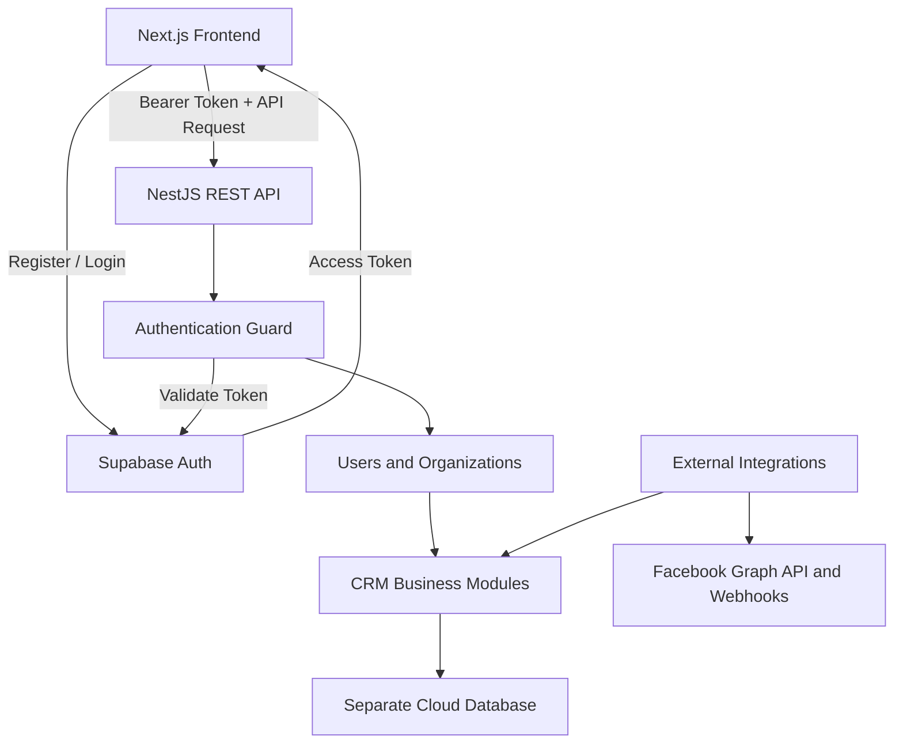

# Sales CRM — Backend Architecture

## 1. Overview

The Sales CRM backend is built with NestJS and follows a modular, feature-based architecture.

The system uses:

- **Backend API:** NestJS + TypeScript
- **Frontend:** Next.js + React
- **Authentication:** Supabase Auth
- **Database:** Separate cloud-hosted database
- **Database access:** Prisma ORM (planned; subject to final selection)
- **API style:** REST API
- **Authorization:** NestJS guards and role/ownership checks
- **External integrations:** Facebook Graph API and Webhooks (future feature)

Supabase is used exclusively for authentication. The CRM business data is stored in the separate application database.

## 2. Architecture Principles

1. Keep business logic inside NestJS.
2. Separate modules by business responsibility.
3. Use Supabase Auth for user identity and session management.
4. Validate access tokens before allowing access to protected API endpoints.
5. Keep authentication separate from authorization.
6. Keep database access behind services or repositories rather than placing queries in controllers.
7. Keep external integrations isolated from CRM business logic.
8. Validate incoming requests and use consistent error responses.
9. Store secrets in environment variables or a managed secrets service.
10. Design the application so additional integrations can be added without restructuring the core CRM.

## 3. High-Level Architecture



### Component Responsibilities

**Next.js**

- Registration and login interfaces
- Session handling
- CRM dashboard and forms
- API requests to NestJS

**Supabase Auth**

- User registration and login
- Password management
- Email verification
- Social login providers, when enabled
- Access token and session management

**NestJS**

- REST API endpoints
- Access token validation
- Authorization and access control
- CRM business logic
- Database operations
- External API integrations

**Application database**

- User profiles
- Organizations and memberships
- Leads, contacts, and deals
- Tasks and activities
- Integration configuration and records

## 4. Project Folder Structure

```text
sales-crm-api/
├── src/
│   ├── main.ts
│   ├── app.module.ts
│   │
│   ├── auth/
│   │   ├── auth.module.ts
│   │   ├── guards/
│   │   │   └── supabase-auth.guard.ts
│   │   ├── decorators/
│   │   │   ├── public.decorator.ts
│   │   │   └── current-user.decorator.ts
│   │   └── interfaces/
│   │       └── authenticated-user.interface.ts
│   │
│   ├── users/
│   │   ├── users.module.ts
│   │   ├── users.controller.ts
│   │   ├── users.service.ts
│   │   ├── dto/
│   │   └── entities/
│   │
│   ├── organizations/
│   ├── leads/
│   ├── contacts/
│   ├── customers/
│   ├── deals/
│   ├── pipelines/
│   ├── tasks/
│   ├── activities/
│   │
│   ├── database/
│   │   ├── database.module.ts
│   │   └── database.service.ts
│   │
│   ├── integrations/
│   │   └── facebook/
│   │       ├── facebook.module.ts
│   │       ├── facebook-auth.service.ts
│   │       └── facebook-graph.service.ts
│   │
│   ├── webhooks/
│   │   └── facebook/
│   │       ├── facebook-webhook.controller.ts
│   │       ├── facebook-webhook.service.ts
│   │       └── processors/
│   │
│   └── common/
│       ├── decorators/
│       ├── filters/
│       ├── guards/
│       ├── interceptors/
│       └── pipes/
│
├── prisma/
│   └── schema.prisma
├── test/
├── .env
├── .env.example
├── .gitignore
├── package.json
├── nest-cli.json
└── tsconfig.json
```

The Facebook integration folders are planned future modules. They do not need to be implemented in the initial authentication milestone.

## 5. Authentication Architecture

Supabase Auth is responsible for authenticating users. NestJS is responsible for validating access tokens and protecting API routes.

### Registration Flow

1. The user submits the registration form in Next.js.
2. Next.js calls Supabase Auth.
3. Supabase creates the authentication account.
4. If email confirmation is enabled, the user confirms their email.
5. The application creates or provisions the corresponding CRM profile in the separate database.
6. The user can access protected CRM endpoints after successful authentication.

### Login Flow

1. The user logs in through Supabase Auth.
2. Supabase returns an access token and session information.
3. Next.js includes the access token in requests to NestJS.
4. NestJS validates the token.
5. NestJS identifies the user using the verified Supabase user ID.
6. Authorization rules determine which CRM records the user may access.

### Protected API Requests

```text
Next.js
   |
   | Authorization: Bearer <access_token>
   v
NestJS Authentication Guard
   |
   | Validate token and claims
   v
Authenticated User
   |
   | Check organization membership and permissions
   v
Controller -> Service -> Database
```

Invalid or expired tokens result in `401 Unauthorized`.

Authenticated users without the required permissions receive `403 Forbidden`.

### Authentication Rules

- Login and registration are handled by Supabase Auth.
- NestJS does not store or verify user passwords.
- The Supabase user UUID is the external identity identifier.
- The application database stores CRM profile and authorization data.
- Public endpoints must be explicitly designated.
- Protected endpoints require a valid access token by default.
- Administrator privileges must be assigned through a trusted process.
- A user's email address alone is not sufficient to establish identity or authorization.

## 6. Database Architecture

The application database is separate from Supabase Auth.

Initial entities include:

| Entity                 | Responsibility                               |
| ---------------------- | -------------------------------------------- |
| User                   | CRM profile linked to a Supabase user UUID   |
| Organization           | Business or workspace                        |
| OrganizationMembership | User's membership and role                   |
| Lead                   | Potential customer                           |
| Contact                | Person associated with a customer or company |
| Customer               | Qualified or existing customer               |
| Pipeline               | Sales pipeline configuration                 |
| Deal                   | Sales opportunity                            |
| Task                   | Follow-up and assigned work                  |
| Activity               | CRM interaction and audit history            |

### User Identity Relationship

```text
Supabase Auth User
        |
        | UUID
        v
Application User Profile
        |
        v
Organization Membership
        |
        v
CRM Permissions and Data Access
```

The application profile must not duplicate password credentials.

The database schema should enforce appropriate foreign keys, unique constraints, and indexes. For a multi-organization CRM, business records should be associated with the appropriate organization.

## 7. API Module Responsibilities

### Auth Module

- Verify Supabase access tokens
- Provide global authentication guards
- Mark explicitly public routes
- Expose the authenticated user through a custom decorator, if useful

### Users Module

- Retrieve and update CRM profiles
- Associate profiles with Supabase user UUIDs
- Manage application-specific account status and roles

### Organizations Module

- Manage workspaces and memberships
- Enforce organization-level access
- Support role assignment and invitations

### CRM Modules

- Leads: lead creation, assignment, qualification, and conversion
- Contacts: contact records and relationships
- Customers: customer lifecycle management
- Deals: opportunities, amounts, stages, and outcomes
- Tasks: follow-ups and assignments
- Activities: interactions and audit history

Each module should contain its own controller, service, DTOs, and persistence logic where appropriate.

## 8. Authorization Model

Authentication and authorization are separate concerns.

**Authentication:** Determines which user is making the request.

**Authorization:** Determines what that user is permitted to do.

Initial roles may include:

| Role        | Access                                                                     |
| ----------- | -------------------------------------------------------------------------- |
| Admin       | Manage organization settings, members, and CRM records according to policy |
| Manager     | Access and manage permitted team records                                   |
| Salesperson | Access assigned leads, customers, deals, and tasks                         |

Roles should be enforced by NestJS and backed by trusted database records. Record ownership and organization membership must be checked server-side rather than trusting identifiers supplied by the frontend.

## 9. External Integrations

External integrations must remain separate from the core CRM modules.

### Planned Facebook Integration

The future Facebook integration will support:

- Facebook OAuth for connecting business Pages
- Secure storage and refresh or renewal handling for supported credentials
- Graph API requests
- Webhook signature validation
- Incoming event processing
- Lead and conversation synchronization

Facebook login through Supabase Auth is not equivalent to connecting a Facebook Page.

Facebook webhook endpoints will not require a CRM JWT. Instead, they will verify Meta's webhook signature and process valid events.

## 10. Environment Configuration

The backend environment will contain configuration such as:

```text
PORT
FRONTEND_URL

SUPABASE_URL
SUPABASE_PUBLISHABLE_KEY

DATABASE_URL
```

Additional secrets may be introduced when required by deployment, database connectivity, or future integrations.

Real secrets must never be committed to source control. `.env.example` should contain variable names and placeholder values only.

## 11. Security Requirements

- Validate Supabase access tokens before processing protected requests.
- Validate request DTOs.
- Use parameterized queries or a supported ORM.
- Enforce organization membership and record-level permissions.
- Apply rate limits to appropriate public endpoints.
- Use HTTPS in production.
- Protect secrets and database credentials.
- Avoid logging access tokens, passwords, or sensitive customer information.
- Use secure session handling in Next.js.
- Test unauthorized and cross-organization access.
- Use appropriate database backups and migration procedures.

## 12. Development Roadmap

### Phase 1 — Backend Foundation

- Initialize NestJS
- Configure environment variables
- Configure the separate database and ORM
- Add Supabase token validation
- Implement the global authentication guard

### Phase 2 — User and Organization Management

- Create CRM user profiles
- Provision the initial administrator
- Add organizations and memberships
- Implement authorization rules

### Phase 3 — Core CRM

- Leads
- Contacts and customers
- Pipelines and deals
- Tasks and activities

### Phase 4 — Frontend Integration

- Registration and login
- Session handling
- Protected dashboard routes
- API integration

### Phase 5 — External Integrations

- Facebook Page authorization
- Graph API integration
- Webhook processing
- Lead and conversation synchronization

## 13. Architectural Decision Summary

The application follows a modular NestJS architecture with clear boundaries between authentication, authorization, CRM business logic, persistence, and external integrations.

Supabase Auth is used exclusively as the identity provider. The separate application database stores CRM data and authorization-related records.

NestJS remains the central backend API and business-logic layer. External services such as Facebook are integrated through dedicated modules and do not control the CRM's core authentication model.
